<h1 align="center">Lantern Hollow</h1>

<p align="center">
<b>A very small tower defense at dusk, in the spirit of Warcraft III's custom maps.</b><br>
Hold the winding road from the rift gate to the hearth with three towers, through eight waves and the Hollow King.
</p>

<p align="center">
<a href="https://saschb2b.github.io/Tower-Defense/play/"><b>Play in the browser</b></a>
&nbsp;·&nbsp;
<a href="https://saschb2b.github.io/Tower-Defense/">Project page</a>
&nbsp;·&nbsp;
<a href="#how-to-play">How to play</a>
&nbsp;·&nbsp;
<a href="CHANGELOG.md">Changelog</a>
</p>

<p align="center">
<a href="https://saschb2b.github.io/Tower-Defense/play/">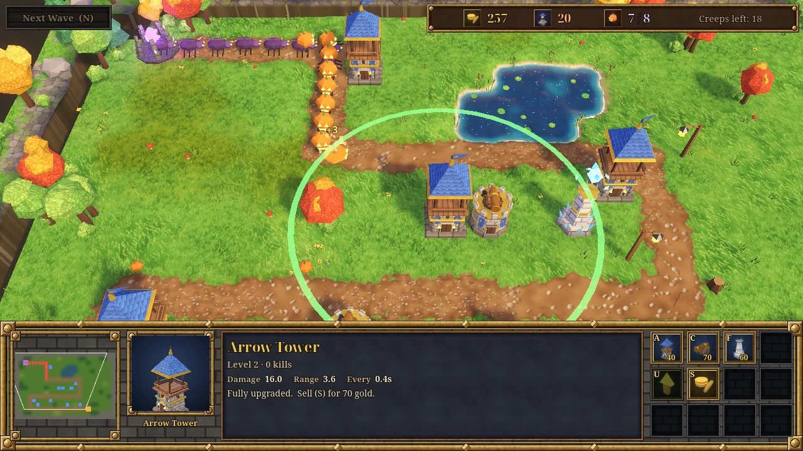</a>
</p>

<p align="center">
An angled camera over a hand-painted hollow, a console with a minimap, a live portrait and a command card,
three towers with an upgrade each, and creeps that walk one road. About six minutes for a full game.
</p>

<h2 align="center">The towers</h2>

<table align="center">
<tr>
<td align="center" width="33%">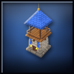<br><b>Arrow Tower · 40</b><br><sub>Quick bolts at the creep closest to the hearth. Upgrade for 60: twice the damage.</sub></td>
<td align="center" width="33%">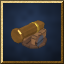<br><b>Cannon Tower · 70</b><br><sub>Slow shells that burst and hit every creep nearby. Upgrade for 80: a bigger blast.</sub></td>
<td align="center" width="33%">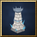<br><b>Frost Spire · 60</b><br><sub>Ice shards that slow creeps by 45% for two seconds. Upgrade for 60: 60%.</sub></td>
</tr>
</table>

<p align="center">
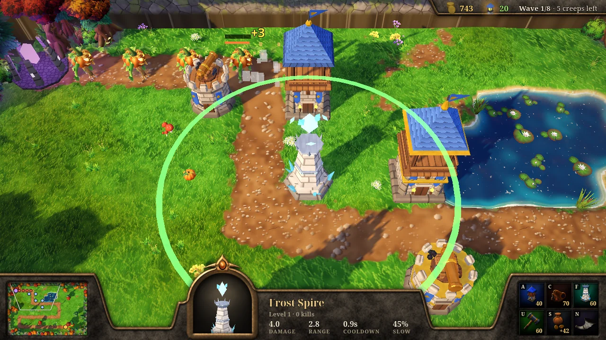
</p>

<h2 align="center">What comes down the road</h2>

<table align="center">
<tr>
<td align="center" width="25%">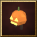<br><b>Gourdling</b><br><sub>Plenty of them, early and often.</sub></td>
<td align="center" width="25%">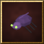<br><b>Scuttler</b><br><sub>Fast and fragile. Frost buys time.</sub></td>
<td align="center" width="25%">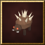<br><b>Thornback</b><br><sub>Slow, tough, costs two lives.</sub></td>
<td align="center" width="25%">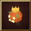<br><b>The Hollow King</b><br><sub>Wave 8. Ten lives if he gets through.</sub></td>
</tr>
</table>

<table align="center">
<tr>
<td align="center" width="50%">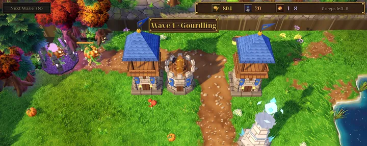<br><sub>Every kill pays gold. Each wave is 22% tougher than the last.</sub></td>
<td align="center" width="50%">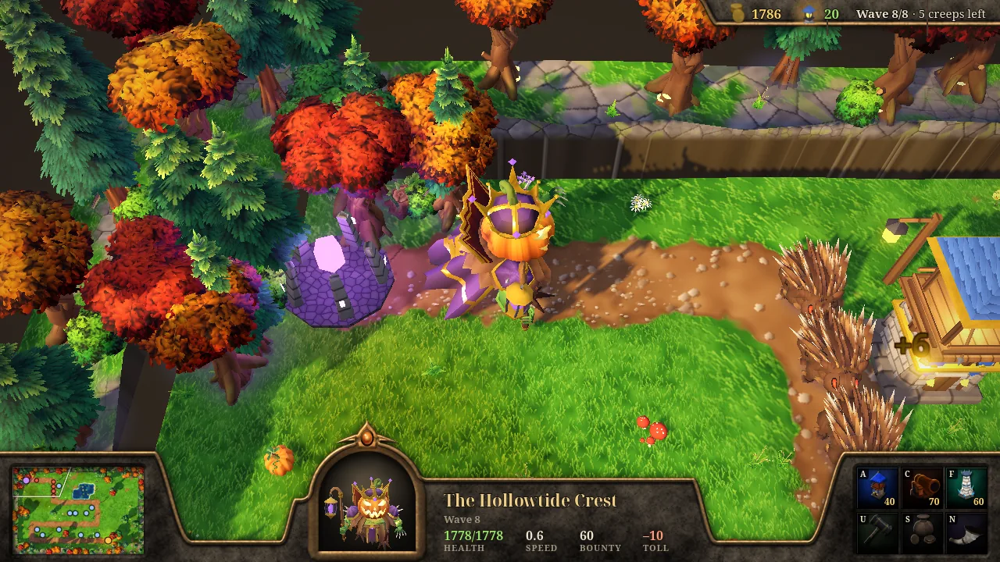<br><sub>Click a creep to see its health in the console.</sub></td>
</tr>
</table>

## How to play

| Input | Does |
|---|---|
| <kbd>A</kbd> <kbd>C</kbd> <kbd>F</kbd> | Choose Arrow Tower, Cannon Tower or Frost Spire, then left-click a grass tile. The ghost turns red where you cannot build; hold <kbd>Shift</kbd> to keep placing |
| Click a tower | Select it and see its range. <kbd>U</kbd> upgrades, <kbd>S</kbd> sells for 70% of what you paid |
| Click a creep | Its health, speed and bounty in the console |
| <kbd>N</kbd> | Call the next wave early; the seconds left are paid as gold |
| Arrow keys, wheel, middle-drag, minimap | Move and zoom the view; <kbd>Home</kbd> shows the whole hollow |
| Right click, <kbd>Esc</kbd> | Cancel building or the selection |

You start with 120 gold and 20 lives. A creep that reaches the hearth costs lives (the Hollow King costs ten).
Clearing a wave pays a bonus, and the next wave starts after ten seconds unless you call it sooner.

## Run it yourself

Godot 4.7.1:

```bash
godot --path .
```

The browser build is what [Pages](.github/workflows/pages.yml) publishes: the `Web` preset in
`export_presets.cfg`, single-threaded so it runs on any static host, with the page in `web/`.

```bash
godot --headless --path . --export-release "Web" build/web/index.html
```

## How it is made

Nothing here comes from Warcraft III or any other game. Every asset was generated for this game, and each one
can be rebuilt from its recipe (`asset_manifest.json` records how):

| Path | What |
|---|---|
| `data/hollow.txt` | The map, one character per tile. The road is traced from `S` to `E`; edit it to redesign the level |
| `art_src/models/` | Recipes for the low-poly towers, props and projectiles: parts with sizes, bevels, colours and painted patterns |
| `art_src/blender/` | Blender build scripts for the trees, plants, rocks and the four rigged, animated creeps |
| `textures/foliage_*.png`, `materials/foliage.gdshader` | Painted needle, leaf, grass and fern cards, tinted per plant and swaying in the wind |
| `materials/painted.gdshader` | Paints bricks, stone, planks, shingles, metal and cloth onto every model, with lit edges and dark grout |
| `textures/`, `shaders/terrain.gdshader`, `shaders/water.gdshader` | Painted grass, meadow, path, sand, mud and rock textures, blended across the tiles with ragged edges; the pond's depth, foam and ripples |
| `models/`, `ui/icons/`, `ui/frames/`, `sfx/` | The generated models, framed command icons, nine-slice console frames and synthesized sounds |
| `asset_style.json`, `palettes/hollow.gpl` | The style every asset is checked against: triangle budgets, sizes, origins, palette, loudness |
| `scripts/` | The game: rules and tables in `game.gd`, waves, building, towers, creeps, projectiles, terrain, the console |
| `tests/scenarios/`, `tests/bot.gd` | Deterministic gameplay tests; a scripted player must win all eight waves and an idle one must lose |
| `tools/media/` | The scenarios that stage the screenshots and the clip above |

The models, textures, icons, frames and sounds were made with [godot-agent-kit](https://github.com/saschb2b/godot-agent-kit),
an agent toolkit for verifying Godot games and building their assets. It also runs the gameplay scenarios, on every push
before the site is published. The fonts are Noto Serif and Noto Serif Display under the SIL Open Font License
([fonts/OFL.txt](fonts/OFL.txt)).

## License

[MIT](LICENSE) for the code and the generated assets. The fonts keep their own license, the SIL Open Font License 1.1.
