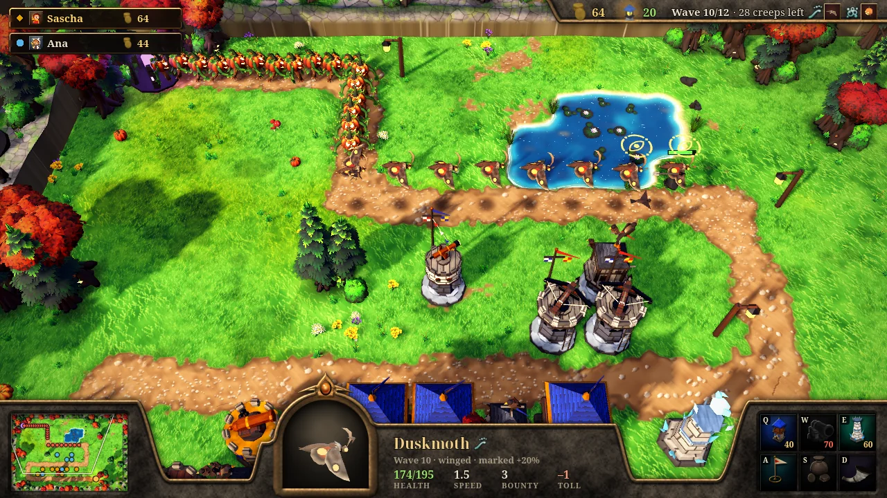
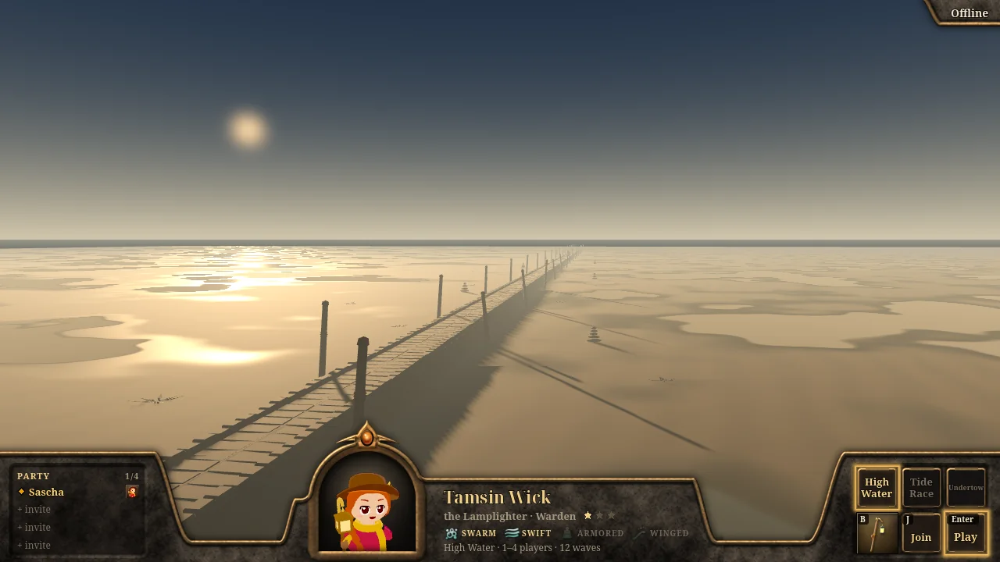
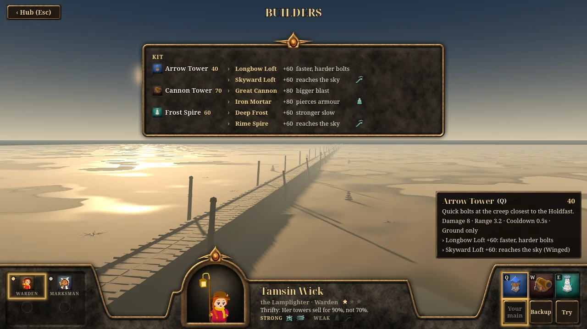
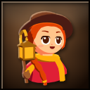
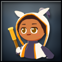
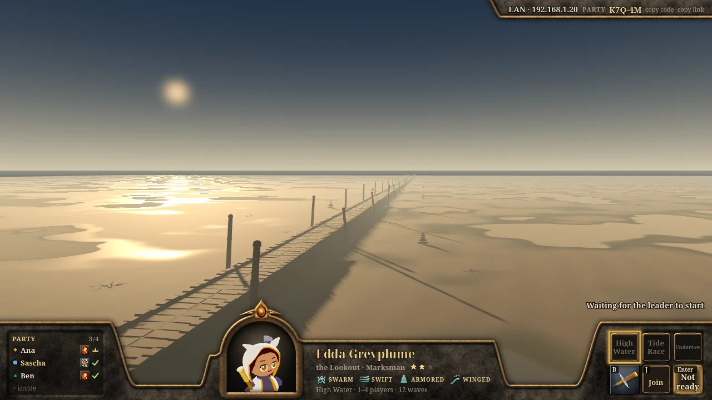
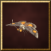
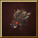
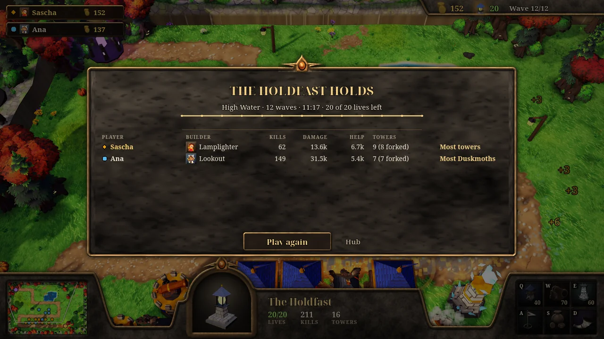
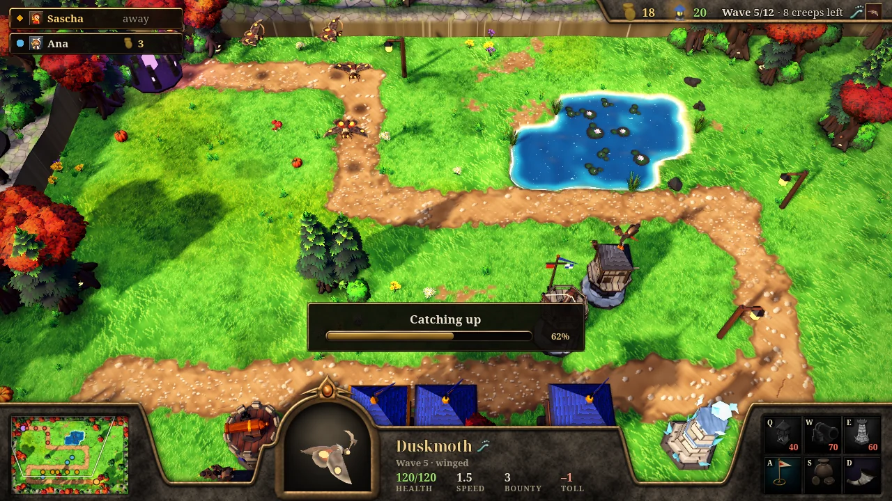

<h1 align="center">Groundhold</h1>

<p align="center">
<b>Every land was raised out of the Tide, and the Tide wants it back; Builders from every shore hold one another's ground.</b><br>
A co-op tower defense for one to four players. Each player is a Builder with three towers of their own, and the
party holds one road together, from the Welling, where the Tide wells up, to the Holdfast.
</p>

<p align="center">
<a href="https://saschb2b.github.io/Groundhold/play/"><b>Play in the browser</b></a>
&nbsp;·&nbsp;
<a href="https://saschb2b.github.io/Groundhold/">Project page</a>
&nbsp;·&nbsp;
<a href="#how-to-play">How to play</a>
&nbsp;·&nbsp;
<a href="#play-together">Play together</a>
&nbsp;·&nbsp;
<a href="CHANGELOG.md">Changelog</a>
</p>

<p align="center">
<a href="https://saschb2b.github.io/Groundhold/play/"></a>
</p>

<p align="center">
High Water on Wickhollow, wave 10 of 12. Duskmoths fly along the road towards Edda's towers, two of them marked
by her Owl's Eye, with Gourdlings behind them. The party strip at the top left shows each player; the console
below shows the selected Duskmoth.
</p>

## The hub

<p align="center">

</p>

The game opens on the Causeway at low water. The console shows your party on the left, your Builder in the arch
with the checks the party covers, and on the right the modes, Builders (<kbd>B</kbd>), Join (<kbd>J</kbd>) and
one button. Alone, Play starts a match at once. The first launch asks for the name the others see.

## Builders

<p align="center">

</p>

<table align="center">
<tr>
<td align="center" width="50%"><br><b>Tamsin Wick, the Lamplighter</b><br><sub>Warden. Covers Swarm and Swift. Arrow Tower, Cannon Tower, Frost Spire. Her towers sell for 90%, not 70%.</sub></td>
<td align="center" width="50%"><br><b>Edda Greyplume, the Lookout</b><br><sub>Marksman. Covers Armored and Winged. Perch Ballista, Hawk Roost, Owl's Eye. Her towers reach 0.4 tiles farther.</sub></td>
</tr>
</table>

Every tower forks once, for good, into one of two branches: one does more of what the tower does, the other
covers something its Builder lacks. Tamsin's Skyward Loft and Rime Spire reach the sky and her Iron Mortar
pierces armour; Edda's Kestrel Flock strikes bounce on to two more creeps and her Pinning Ballista slows. The
Owl's Eye marks the toughest creep in reach, and every tower hits it 20% harder.

Builders (<kbd>B</kbd>) shows each Builder's kit with both branches. Set your main and your backup there, or Try
one in a practice match.

## Parties

<p align="center">

</p>

A party is up to four players on one server. Join (<kbd>J</kbd>) takes a party code in any case, with or without
its hyphen; on desktop it also lists the servers it hears on your network, and takes an address
(`192.168.1.20` is a server on the LAN). The strip at the top right shows the code to pass on. Everyone says
Ready, the leader starts, and anyone can cancel the 3-2-1. Loading shows a card per player and names whom
everyone waits for.

## High Water on Wickhollow

Twelve waves on Wickhollow's winding road, with one pool of 20 lives and each player's own gold. The early waves
teach one check each:

<table align="center">
<tr>
<td align="center" width="25%"><br><b>Swarm</b><br><sub>Gourdlings, many at once.</sub></td>
<td align="center" width="25%"><br><b>Swift</b><br><sub>Scuttlers, fast and fragile.</sub></td>
<td align="center" width="25%"><br><b>Armored</b><br><sub>Thornbacks. Armour takes a flat amount off every hit, at most three quarters.</sub></td>
<td align="center" width="25%"><br><b>Winged</b><br><sub>Duskmoths fly: only towers that reach the sky aim at them.</sub></td>
</tr>
</table>

<table align="center">
<tr>
<td align="center" width="50%"><br><b>The Bristlesow</b><br><sub>Wave 6. A larger, darker Thornback.</sub></td>
<td align="center" width="50%"><br><b>The Hollowtide Crest</b><br><sub>Wave 12. Ten lives if it gets through.</sub></td>
</tr>
</table>

Creeps get tougher with every wave and with every player. The strip shows the next wave's checks; the hub's
coverage row shows which ones your party answers. Slows and marks never stack (the strongest applies), and a hit
on a creep a teammate slowed or marked counts as that teammate's Help.

## Results

<p align="center">

</p>

The results give each player's kills, damage, Help and towers, and a line of praise. Play again goes back to the
hub with the party as it was.

## How to play

| Input | Does |
|---|---|
| <kbd>Q</kbd> <kbd>W</kbd> <kbd>E</kbd> | Your three towers: choose one, then left-click a grass tile (hold <kbd>Shift</kbd> to keep placing). On your own tower that has not forked, they choose a branch |
| Click a tower or a creep | Its numbers in the console. A teammate's tower names its owner |
| <kbd>A</kbd>, or <kbd>Alt</kbd>+click | Signal: a ring in your colour, "look here" |
| <kbd>S</kbd> | Sell your selected tower for 70% of what you paid |
| <kbd>D</kbd>, <kbd>N</kbd>, <kbd>Space</kbd> | Ready: the next wave comes when everyone is Ready, and the seconds left are paid as gold |
| Arrow keys, wheel, middle-drag, minimap | Move and zoom the view; <kbd>Home</kbd> shows the whole map |
| Right click, <kbd>Esc</kbd> | Cancel; with nothing to cancel, <kbd>Esc</kbd> opens the menu (Resume, Restart offline, Leave to hub) |

Each player starts with 120 gold. Every kill pays its full bounty to every player, clearing a wave pays a bonus,
and a creep that reaches the Holdfast costs the party lives.

## Play together

**In the browser** the game plays alone, and Try, at once. Parties in the browser are online only: a page
served over https cannot reach a server on your home network. The official server goes up with M5, and with it
the link on the party strip (copy link) that opens the game in a friend's browser and joins your party.

**On desktop** a party plays over your network. Desktop builds and a packaged server to download come with M5;
until then run both from this repository. One computer runs the server (Python 3.11 or newer, nothing else to
install):

```bash
python3 server/main.py
```

Its banner prints the address to type. In the game, Join (<kbd>J</kbd>) lists the server under Nearby, or type
its address: that makes a party there. The others join with the code on your strip. `server/README.md` has the
settings, moderation and backups.

**Two windows on one computer:**

```bash
python3 server/main.py --host 127.0.0.1 --state-dir /tmp/groundhold-state
godot --path . -- --server=127.0.0.1 --name=Tamsin
godot --path . -- --server=127.0.0.1 --name=Edda --main=lookout --code=K7Q4M   # the code on the first window's strip
```

Both say Ready, the first window starts, and Play again brings both back to the party.

### When something goes wrong

A small bronze plate above the console says what is happening; the match never stops for it.

<p align="center">

</p>

- **Your link drops.** Your towers keep firing on every screen. After 5 s without a word from your game, the
  caretaker plays your seat: it follows your Builder's plan with your gold, forks for what the team lacks and is
  always Ready. The others see "away" on their party strip. Your game says "Reconnecting... your towers keep
  firing" and tries again every 2 s, for up to 30 s. Once back in, it loads the last state every game agreed on
  and catches up under a bar ("Catching up 62%"). The caretaker hands your seat back at the next build window
  ("back next window" on the strip, and "Welcome back" over the console says after which wave); until then your
  orders wait and the game says why. The others get a notice as your link drops and as you come back. If the
  match ended while you were gone, the game takes you back to the party.
- **The game is in another tab.** A hidden browser tab stops the game, but the server keeps its link for up to
  ten minutes. The others see "in another tab" on their strip, the caretaker takes your seat after 5 s, and the
  page's title flashes. When you come back the game catches up under the same bar and says "Welcome back" and
  when the caretaker hands back: after this wave, or after the coming one while a build window is open.
- **The lands fall out of step.** Every game simulates the whole match, and they compare a state hash every
  second. With three or more players, a game that differs alone is reloaded from the last agreed state and plays
  on; if it happens to the same game again, that player goes back to the hub and the caretaker keeps the seat.
  With two players, or with no majority, the match ends: "The lands fell out of step", and the results say the
  games disagreed. Each game saves a report: Show report on the results opens its folder (on Linux
  `~/.local/share/godot/app_userdata/Groundhold/desync/`), and in the browser Save report downloads it. Please
  attach it to an issue.

## Run it yourself

Godot 4.7.1:

```bash
godot --path .
```

The browser build is what [Pages](.github/workflows/pages.yml) publishes: the `Web` preset in
`export_presets.cfg`, single-threaded so it runs on any static host, with the page in `web/`.

```bash
godot --headless --path . --export-release "Web" build/web/index.html
```

The tests run with [godot-agent-kit](https://github.com/saschb2b/godot-agent-kit) (`AGENTS.md` lists them all):

```bash
godot-agent scenario . tests/scenarios --headless                  # every gameplay test
godot-agent scenario . tests/balance --headless                    # High Water's balance gates
python3 -m unittest discover -s server/tests -t server/tests       # the server
godot-agent scenario . tools/media                                 # the screenshots on this page
```

## How it is made

Every asset was generated for this game, and each one can be rebuilt from its recipe (`asset_manifest.json` records
how):

| Path | What |
|---|---|
| `data/hollow.txt` | The map, Wickhollow, one character per tile. The road is traced from `S` to `E` |
| `data/plans/` | Each Builder's plan, which the caretaker and the bots play |
| `art_src/models/` | Recipes for the low-poly towers, props and projectiles: parts with sizes, bevels, colours and painted patterns |
| `art_src/blender/` | Blender build scripts for the trees, plants, rocks and the rigged, animated creeps; `builders/` for Tamsin and Edda as chibi toon figures with their busts; `causeway/` for the hub's road, tide poles, cairns and wrack |
| `materials/painted.gdshader`, `materials/builder_toon` | The painted look of towers and creeps (bricks, stone, planks, shingles, metal, cloth), and the two-tone shading only Builders wear |
| `textures/`, `shaders/` | Painted terrain textures blended across the tiles, the pond, and the flats under the Causeway |
| `art_src/ui/console.py`, `icons.py` | The painters of the bronze console (wings, wells, the arched portrait window, panels, cards, fields and bars) and of the command, check and role icons. They need only Pillow and write `ui/console/layout.json`, which the HUD and the hub place themselves by |
| `models/`, `ui/icons/`, `ui/console/`, `sfx/` | The generated models, icons, painted console pieces and synthesized sounds |
| `asset_style.json`, `palettes/` | The style every asset is checked against: triangle budgets, sizes, origins, palettes, loudness |
| `scripts/` | The game: the rules as an integer simulation in `sim/` (tables in `sim/content.gd`) that every machine steps the same way from the same turns; the views, the hub (`ui/`), the session around a match (`session/`) and the network client (`net/`) |
| `server/`, `shared/net/` | The server, which keeps parties and passes turns but never simulates, and the wire contract both sides read |
| `docs/design/` | The design (`core-loop.md`) and the world and its names (`world.md`) |
| `tests/` | Deterministic gameplay scenarios, the balance gates, loopback and live network tests, and the plan bot |
| `tools/` | `net/smoke.py` (whole matches against the real server, hash streams compared), `names_check.py`, `gen_balance_scenarios.py`, and `media/`, the scenarios that stage the screenshots above |

The models, textures, icon renders and sounds were made with [godot-agent-kit](https://github.com/saschb2b/godot-agent-kit),
an agent toolkit for verifying Godot games and building their assets. It also runs the gameplay scenarios, on every push
before the site is published. The fonts are Noto Serif and Noto Serif Display under the SIL Open Font License
([fonts/OFL.txt](fonts/OFL.txt)).

## License

[MIT](LICENSE) for the code and the generated assets. The fonts keep their own license, the SIL Open Font License 1.1.
