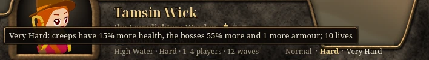
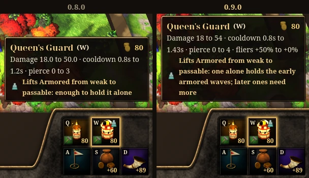
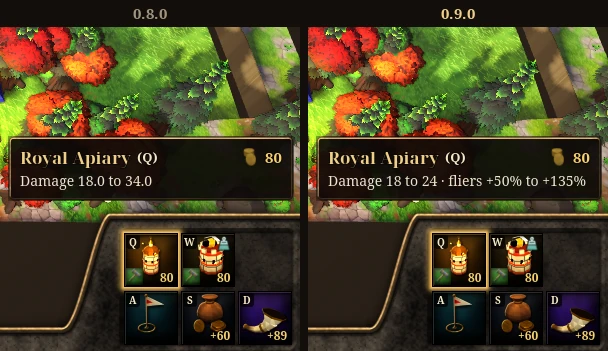
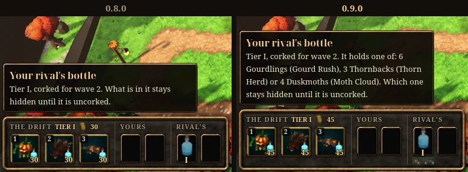

<h2 align="center">Call the next wave.</h2>

<b>New in 0.9.0:</b> the horn now calls the next wave while one is still running, up to three on the road at once, and pays you for the window you skip and for the lives at stake. A party's leader picks Normal, Hard or Very Hard. Every tower's two forks now each have a job of their own, a life lost in Tide Race costs a whole minute, and in Undertow a pack you send can break through a defence that is weak to it.

<!-- downloads -->

---

## 📯 Call the next wave

In High Water and Tide Race the horn works during a wave too: <kbd>D</kbd>, <kbd>N</kbd>, <kbd>Space</kbd> or a click calls the next wave, and it sets out at once, its creeps walking in among the ones already on the road. Call early in a wave and both whole waves come at you together; call once the wave has set out and the new one walks in behind it. A call takes a second press within two seconds, so a stray key never sends a wave.

 

A call pays the whole window it skips (10 gold alone, 15 with company) and 2 gold for every 5 lives the waves on the road could still take, so the earliest calls pay the most: wave 2 called as wave 1 begins pays 14. The horn's tooltip says what a call would pay and what the wave brings. Up to three waves walk the road at once, and the last wave is never called early. With waves together the strip reads "Waves 7–8/12" and counts all their creeps, the waves to come start at the oldest, and each wave still clears on its own banner with its own bonus.

It is a gamble. A Builder alone who calls every wave loses at least 5 lives more than one who calls only the waves its towers are made for, or falls. Beside another player the call waits until everyone has sounded the horn, and the strip says who has ("Ready 1/2"). In Tide Race each crew stacks on its own clock, and the caretaker calls early the waves its Builder is built for, at Normal only. Undertow and the classic match never stack.

---

## 🔥 Hard and Very Hard

The hub shows Normal · Hard · Very Hard beside the mode line. The party's leader picks the level and every member sees it; changing it clears every Ready. Hover a level and it says what it changes:

| Level | Lives | Creeps | The Bristlesow and the Hollowtide Crest |
| --- | --- | --- | --- |
| Normal | 20 | as before | as before |
| Hard | 15 | 10% more health | 50% more health, 1 more armour |
| Very Hard | 10 | 15% more health | 55% more health, 1 more armour |

Gold, waves, windows, bounties and tolls stay as they are at every level. Very Hard is a close finish at wave 12: the caretaker playing each Builder alone kills the Crest a few seconds before it reaches the Holdfast and wins on 1 to 5 lives. The waves to come give every creep's health and armour at the level you play:

Play, Try and Race the caretaker play the level the hub shows. The queue only puts parties of one level together, and the caretakers it offers after a minute play at the party's level. Any level but Normal is named wherever the mode is: the hub, Match Found, the loading screen, the results ("4 of 10 lives left") and the Esc menu. Undertow and the classic match always play at Normal.

---

## 🍴 Every fork, a choice

Each branch now does a quarter more than its sibling at its own job, and neither is ahead at both, at every level and party size. The Beekeeper's Apiary shows it best: the Royal Apiary is her tower for the sky, 24 a bolt and 56.4 against a flier, so a late Duskmoth takes two; the Queen's Guard is for armour, 54 every 1.43 s, ignoring 4 armour, no bonus against fliers, and it aims at the creep with the most health in its reach. A branch that covers a check its Builder is weak to now says what "passable" means: what one tower of it holds alone.

- **Beekeeper:** the Great Clay Hive stings for 5 (was 4), the Drowsy Clay Hive for 1.5 (was 3) and slows by 35% (was 25%), the Long Hum hastens by 18% (was 15%).
- **Lamplighter:** the Iron Mortar hits 52 (was 45). Her Arrow, Cannon and Frost Spire and their first branches, which the classic match plays, are unchanged.
- **Lookout:** the Kestrel Flock's strikes bounce on to three more creeps (was two), and the Twin Gaze marks for +25% (was +20%).
- **Bellfounder:** the Clapper Tower strikes for 35 (was 30), the Great Clapper for 80 every 1.4 s (was 72 every 1.6 s), the Ringing Clapper for 32 over 1.2 tiles (was 24 over 1.0); the Sky Toll slows fliers by a third (was half) and does 160% more to them (was 80%), and the Long Chime cracks 3 armour within 4 tiles (was 2 within 3.2).

---

## ⏱️ A minute a life in Tide Race

A life lost now adds a minute to your race time, where it added 10 seconds. With waves that truly overlap, a crew that called every wave early saved three or four minutes, and 10 seconds a life paid for any leak. Now calling every wave wins a race only for a crew whose defence holds three waves at once; a crew that leaks for it loses to the same crew calling only the waves it is built for. Your clock and your rival's show the lives' part in seconds, and Tide Race's button in the hub says the rule.

---

## 🍾 Undertow: sends that bite

A pack you send now often costs your rival lives. Its creeps come stronger than the wave's own, as the Drift tray says, and every pack, the Moth Cloud and the three others, breaks through the Builders weak to its check: the Gourd Rush sends 6, 14 or 20 Gourdlings, half again as strong and bunched close, to swamp a defence that strikes one creep at a time; the Scuttle 8, 17 or 28 Scuttlers; the Thorn Herd 3, 5 or 9 Thornbacks, a second apart, so only hits that go through armour hold them; the Moth Cloud 4, 5 or 7 Duskmoths. Against the caretaker each pack now takes a life from a Builder weak to it about half the time. A tier I cork costs 45 gold, and a tier III pack adds 12 gold a wave to your stipend. Below, a Moth Cloud corked in the second window, four Duskmoths, gets through a rival Lamplighter's defence:

A rival's corked bottle now shows what it may hold, never which one: its window's packs at its tier, small under the bottle in the tray and named in its tooltip, and the duel bar's rival row ends with their checks, so you know which defence to save gold for.

The caretaker now sends what your defence has shown, all of it what you could see too: the check it has let through most, a Moth Cloud when your towers hardly reach the sky, otherwise the pack your towers take longest to kill. About half the packs it sends now take a life, where one in four did.

---

## Everything else

- At Normal the Bristlesow, wave 6's boss, now dies to every Builder's plan alone. It used to walk through the Lamplighter's and the Lookout's for 5 lives; their caretakers now open with an Iron Mortar and a Siege Perch. The boss itself is unchanged.
- The Bellfounder and the Lookout alone now win Hard and Very Hard with the caretaker's openings, and the Beekeeper's caretaker forks a Queen's Guard before a Royal Apiary, so wave 4's Thornbacks meet a tower made for armour.
- The results' Towers column counts the towers standing at the end and how many of them are forked, "9 (4 forked)". It counted every fork ever made, a sold tower's too.
- Tower and creep numbers show at most two decimals, and none they do not need: the Queen's Guard's cooldown reads 1.43s, a fork's damage "18 to 54", a Thornback's speed 0.85.
- The Sky Toll says it holds fliers only inside a bend of the road, and the Rime Spire and the Drowsy Clay Hive say that alone they hold no wave.
- Normal · Hard · Very Hard stay where they are when you click one.
- In a duel, hovering the rival's corked bottles at the end of the duel bar explains them, as the Drift tray does.
- Games and servers of different versions now say which one needs updating: an older game is told "A newer version is out".
- Every detail is in the [changelog](../../CHANGELOG.md).
