

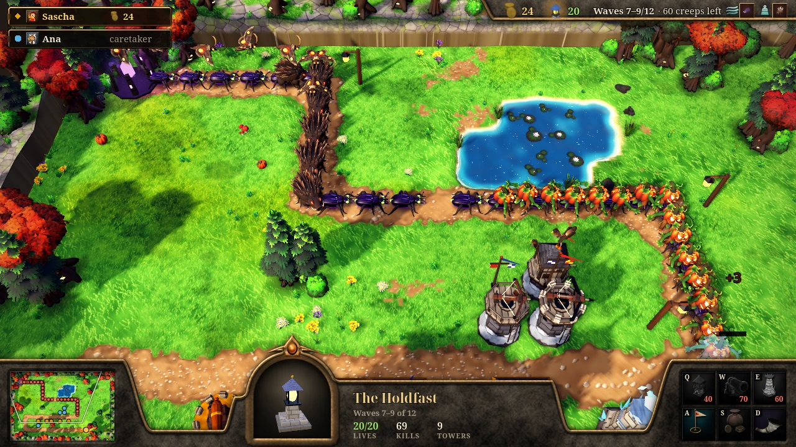

<h2 align="center">Three waves on the road.</h2>

<b>New in 0.9.0:</b> you can call the next wave while one is still on the road, up to three at once, and earn gold for the risk. Your party picks Normal, Hard or Very Hard, every fork now has a job of its own, a lost life costs a minute in Tide Race, and the packs you send in Undertow break through more often.

<!-- downloads -->

---

## 📯 Call the next wave

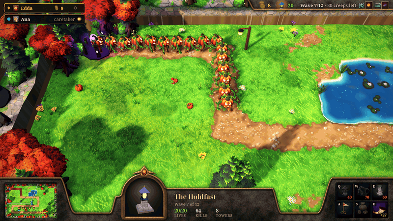

In High Water and Tide Race the horn (Ready, <kbd>D</kbd>) now works during a wave. Press <kbd>D</kbd>, <kbd>N</kbd> or <kbd>Space</kbd>, or click it, twice within two seconds, and the next wave sets out at once among the creeps already on the road. Up to three waves can walk the road together, and the last wave can't be called early.

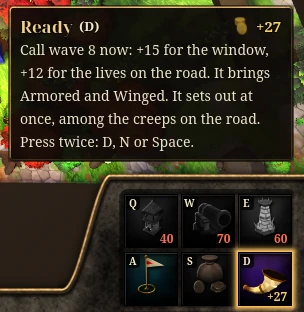 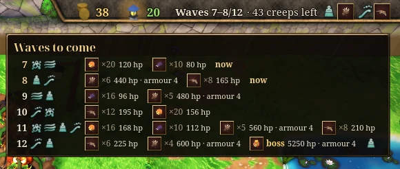

A call pays the gold of the build time it skips (10 alone, 15 in a party) plus 2 gold for every 5 lives the waves on the road could still take, so the earliest calls pay the most; the horn's tooltip shows the sum and the creep types coming. The strip then reads "Waves 7–8/12", and each wave still clears with its own bonus; waves that clear at the same moment share one banner, "Waves 1–2 cleared".

It is a gamble: a Builder playing alone who calls every wave early loses at least 5 more lives than one who calls only the waves its towers handle well, or loses the match. In a party the call waits until everyone has sounded the horn ("Ready 1/2"). Undertow and the classic match never call early.

---

## 🔥 Hard and Very Hard

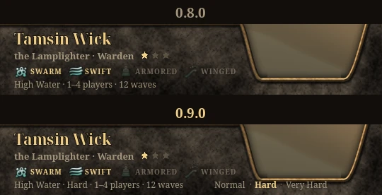

Your party's leader picks the level beside the hub's mode line, and everyone sees it.

| Level | Lives | Creeps | The Bristlesow and the Hollowtide Crest |
| --- | --- | --- | --- |
| Normal | 20 | as before | as before |
| Hard | 15 | 10% more health | 50% more health, 1 more armour |
| Very Hard | 10 | 15% more health | 55% more health, 1 more armour |

Gold, waves, build time and bounties are the same at every level. Very Hard is close: the caretaker, the AI that fills an empty seat, wins it with every Builder solo, killing the Crest at wave 12 seconds before it reaches the Holdfast, with 1 to 5 lives left. The waves to come show each creep's health and armour at your level:

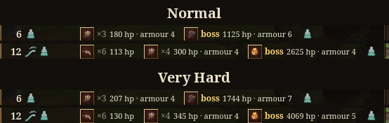

Play, Try and Race the caretaker play the hub's level, and the queue only matches parties of the same level. Undertow and the classic match always play at Normal.

---

## ⚖️ Every fork, a choice

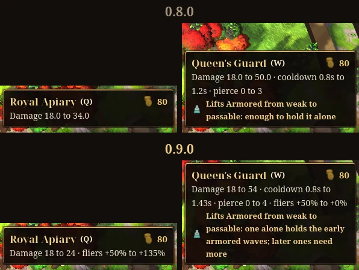

The Beekeeper's Royal Apiary now hits a flier for 56.4, so a late Duskmoth falls to two bolts; anything else it hits for 24. Her Queen's Guard is for armour: 54 every 1.43 s, ignoring 4 armour, aimed at the creep with the most health in reach. Every tower's two forks now split like this: each is a quarter better than the other at its own job, and neither is better at both.

- **Beekeeper:** Great Clay Hive 5 a sting (was 4); Drowsy Clay Hive 1.5 (was 3), slowing 35% (was 25%); Long Hum hastens 18% (was 15%).
- **Lamplighter:** Iron Mortar 52 (was 45). The towers the classic match plays are unchanged.
- **Lookout:** Kestrel Flock strikes bounce to three more creeps (was two); Twin Gaze marks for +25% (was +20%).
- **Bellfounder:** Clapper Tower 35 (was 30); Great Clapper 80 every 1.4 s (was 72 every 1.6 s); Ringing Clapper 32 over 1.2 tiles (was 24 over 1.0); Sky Toll slows fliers by a third (was half) and does 160% more to them (was 80%); Long Chime cracks 3 armour within 4 tiles (was 2 within 3.2).

---

## ⏱️ A minute a life in Tide Race

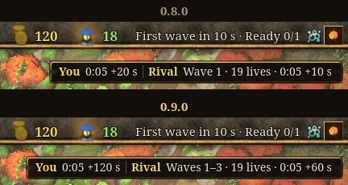

A life lost now adds a minute to your race time instead of 10 seconds. With waves on the road together, calling every wave early saved three or four minutes, so any leak was worth it; now it wins only for a crew whose defence holds three waves at once. Both race clocks show the lives' part in seconds. Each crew calls early on its own clock, and the caretaker calls early only the waves its Builder handles well, and only at Normal.

---

## 🍾 Undertow: sends that bite

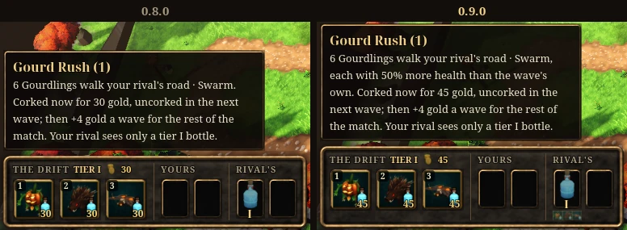

A pack you send now often costs your rival lives. Before, only the Moth Cloud broke through; now every pack comes stronger than the wave's own and breaks through the Builders weak to it. The Gourd Rush swamps a defence that strikes one creep at a time; only hits that go through armour hold the Thorn Herd. Against the caretaker each pack takes a life from a Builder weak to it about half the time. A tier I cork costs 45 gold, and a tier III pack adds 12 gold a wave to your stipend. Here a Moth Cloud, four Duskmoths, gets through a rival Lamplighter's defence:

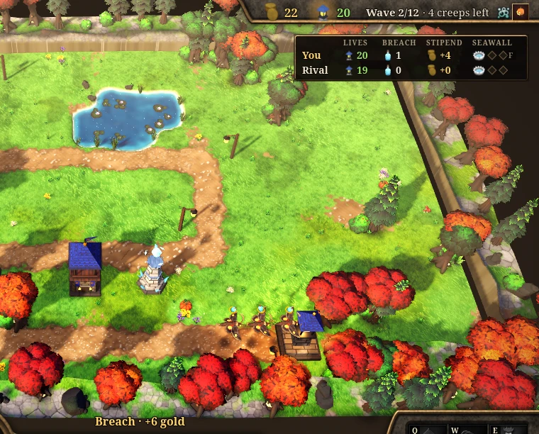

A rival's corked bottle now tells you what it might hold, never which. Its tooltip lists the packs it may be ("It holds one of: 6 Gourdlings (Gourd Rush), 3 Thornbacks (Thorn Herd) or 4 Duskmoths (Moth Cloud)"), and the duel bar's rival row ends with their creep types, so you know which defence to save gold for.

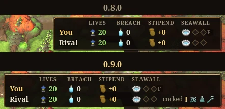

The caretaker now picks its sends from what your defence has shown on the board: the creep type it lets through most, a Moth Cloud when your towers hardly reach the sky, otherwise the pack your towers take longest to kill.

---

## Everything else

- At Normal the Bristlesow, wave 6's boss, now dies to the caretaker playing any Builder solo; the Lamplighter and the Lookout used to let it through for 5 lives. The boss itself is unchanged.
- The Beekeeper's caretaker forks a Queen's Guard first, so wave 4's Thornbacks meet a tower made for armour.
- The results' Towers column counts the towers standing at the end, "9 (4 forked)", not every fork ever made.
- Numbers show at most two decimals: the Queen's Guard's cooldown reads 1.43s, a Thornback's speed 0.85.
- Tooltips say more: a fork that covers a creep type its Builder is weak to says what one tower of it holds alone, the Sky Toll that it holds fliers only inside a bend, and the Rime Spire and the Drowsy Clay Hive that alone they hold no wave.
- A game and a server of different versions say which one needs updating ("A newer version is out").
- Every detail is in the [changelog](../../CHANGELOG.md).
